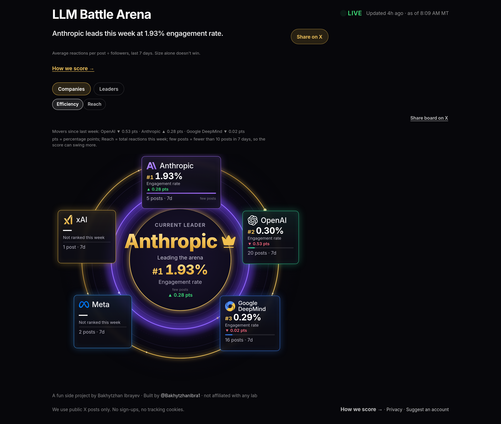
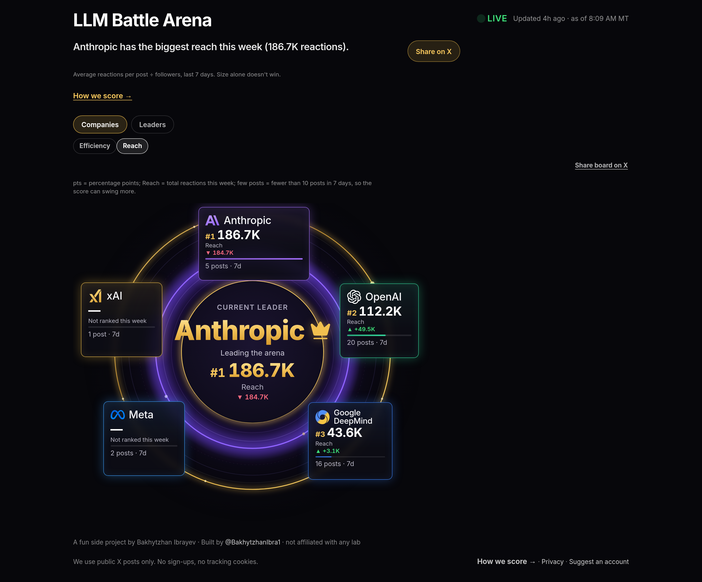
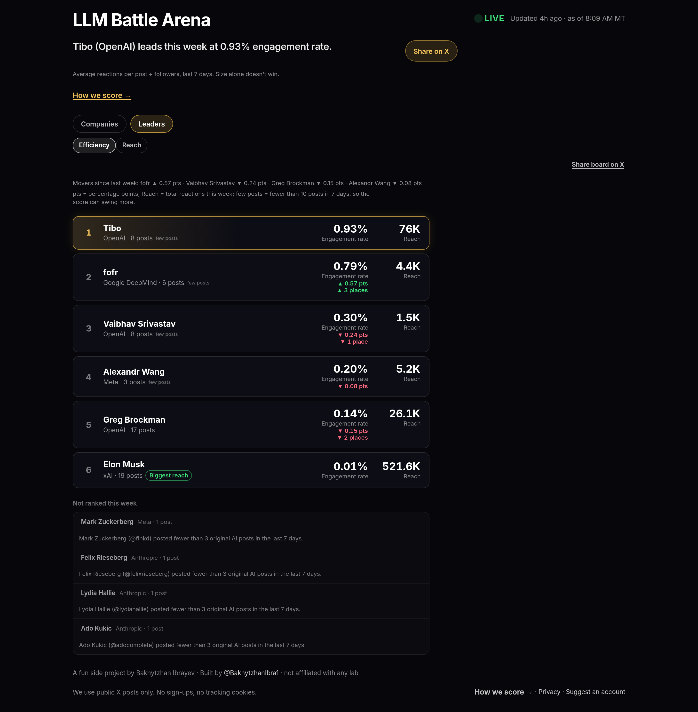
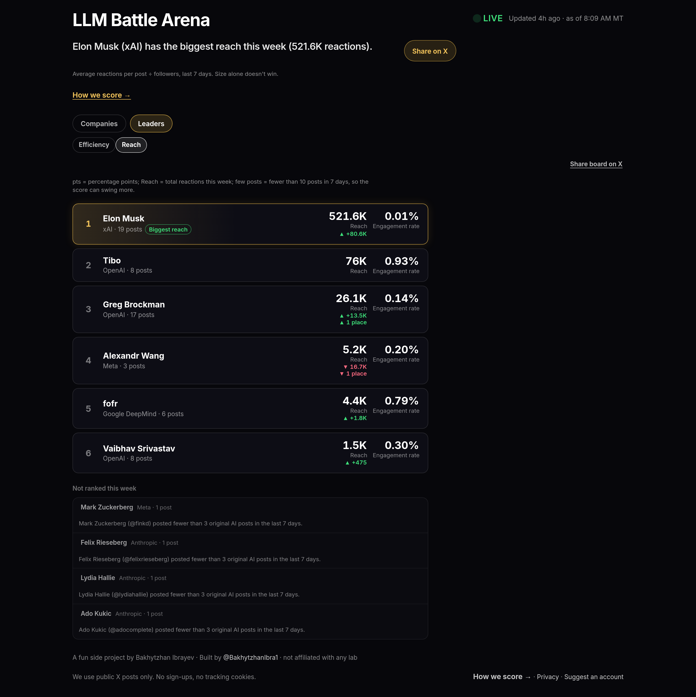
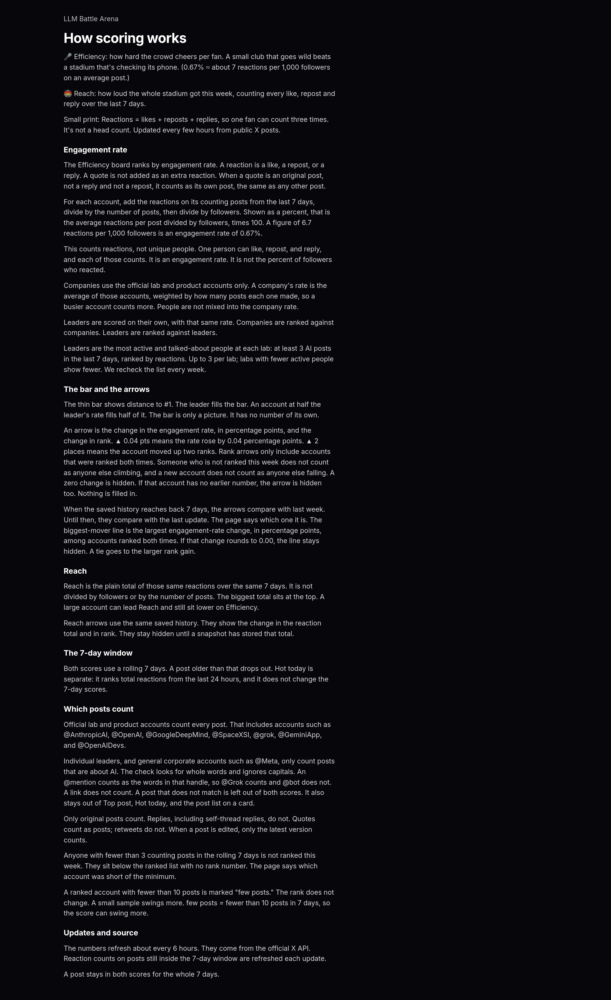

# LLM Battle Arena

**A live leaderboard of how AI labs and their people are doing on X.**

I built this to see whether the leading AI products also lead in attention on social media. It ranks official lab and product accounts, and the most active people at those labs, using public posts on X. It is not a measure of which AI is best.

**Live site:** [https://www.llmbattle.tech](https://www.llmbattle.tech)

The same site is also at [https://llm-battle-arena-liard.vercel.app](https://llm-battle-arena-liard.vercel.app).

The screenshots below were taken on 21 November 2026 (America/Edmonton). Rankings change as the numbers refresh.

## Screenshots

Post text is not shown here. The live site also has a "Hot today" row and a recent-posts panel; those are left out of the screenshots.

**Companies · Efficiency** (engagement rate over the last 7 days)

**Companies · Reach** (total reactions over the last 7 days)

**Leaders · Efficiency**

**Leaders · Reach**

**How scoring works**

## How scoring works

The method is written out in full on the live [How scoring works](https://www.llmbattle.tech/method) page. In short:

- **Two boards.** Companies are ranked against companies. Leaders are ranked against leaders. People are not mixed into a company's score.
- **Efficiency** is engagement rate over a rolling 7 days: add the reactions on an account's counting posts, divide by the number of posts, then divide by followers. It is shown as a percent. A figure of 6.7 reactions per 1,000 followers is an engagement rate of 0.67%.
- **A reaction** is a like, a repost, or a reply. A quote is not added as an extra reaction. When a quote is an original post, it counts as its own post.
- This counts reactions, not unique people. One person can like, repost and reply, and each of those counts.
- **Reach** is the plain total of those same reactions over the same 7 days. It is not divided by followers or by the number of posts. A large account can lead Reach and still sit lower on Efficiency.
- **Hot today** ranks total reactions from the last 24 hours and does not change the 7-day scores.
- **Which posts count.** Official lab and product accounts count every original post. Individual leaders, and general corporate accounts such as @Meta, only count posts that are about AI. Replies (including self-thread replies) do not count. Quotes count as posts; retweets do not. When a post is edited, only the latest version counts.
- Anyone with fewer than 3 counting posts in the rolling 7 days is not ranked that week. A ranked account with fewer than 10 posts is marked "few posts"; the rank does not change, but a small sample can swing more.
- A company's rate is the average of its official lab and product accounts, weighted by how many posts each one made.
- Leaders are the most active and talked-about people at each lab: at least 3 AI posts in the last 7 days, ranked by reactions, up to 3 per lab. The list is rechecked every week.
- The numbers refresh about every 6 hours from the official X API. Reaction counts on posts still inside the 7-day window are refreshed each update.

## Tech stack

- **Frontend:** Next.js, React, TypeScript, hosted on Vercel
- **Data updates:** a Python script, run on a scheduled GitHub Action

## My role

Product idea, design and full-stack build by Bakhytzhan Ibrayev.

## Source code

The source code is private and is not included in this repository. It is available on request.

---

© 2026 Bakhytzhan Ibrayev. All rights reserved.
